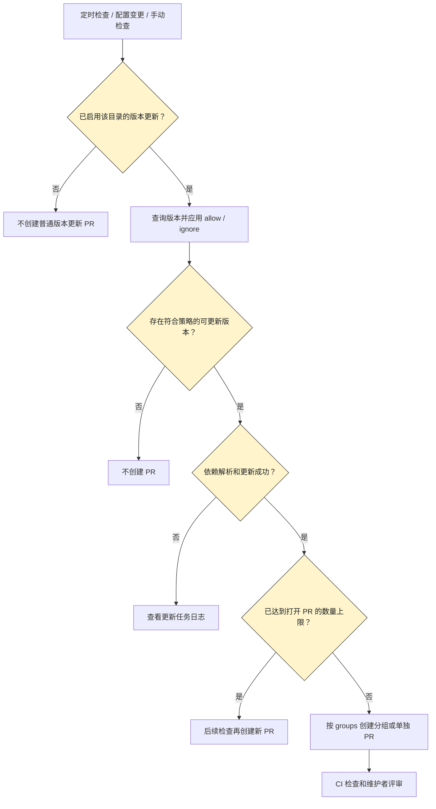

# 依赖管理与 Dependabot 操作指引

面向维护 bk-nodemgr 仓库依赖的开发者，用于执行人工升级、维护禁用策略、处理已有 Dependabot PR 和排查更新任务。

## 项目策略

bk-nodemgr 不采用依赖机器人自动创建 PR。依赖升级由维护者按实际需求安排，确认兼容性、验证范围和回滚方案后人工提交 PR，不因上游发布新版本自动发起升级。

- 普通版本更新：所有更新条目均设置 `open-pull-requests-limit: 0`，配置合入默认分支后生效。
- 安全更新 PR：在仓库 `Settings -> Advanced Security` 的 Dependabot 设置中保持 `Dependabot security updates` 禁用。该功能独立于版本更新数量上限，不能只靠 YAML 禁用。
- 漏洞告警：保留 `Dependabot alerts`，由维护者评估告警并安排修复；禁用自动 PR 不应关闭漏洞发现能力。
- 已有 PR：禁用新建 PR 不等于清理历史 PR，由维护者判断是否仍需升级后保留或关闭。

保留 `dependabot.yml` 的生态和目录条目，显式记录禁用策略；`schedule` 是配置所需字段，不表示允许创建 PR。下文的自动更新配置示例仅供理解机制和经明确决策后重新启用时参考，不是当前项目默认策略。

## 先选择操作

| 需求                       | 操作                                                    |
| -------------------------- | ------------------------------------------------------- |
| 确认为什么创建了 PR        | 查看 PR 类型、目标目录和 Dependabot 更新任务日志        |
| 保持自动建 PR 禁用         | 检查所有条目的数量上限为 `0`，安全更新 PR 设置为禁用    |
| 人工升级依赖               | 确认升级必要性和目标版本，按贡献指引验证并提交 PR       |
| 减少普通版本更新 PR        | 调整 `schedule`、`open-pull-requests-limit` 和 `groups` |
| 暂不升级某个依赖或版本     | 在对应更新条目中配置 `ignore`                           |
| 只维护指定依赖             | 配置 `allow`；同时匹配 `ignore` 时以忽略为准            |
| 暂停某个目录的普通版本更新 | 设置该条目的 `open-pull-requests-limit: 0`              |
| 修改现有 PR 标题或正文     | 使用 GitHub 页面或 `gh pr edit`，不必修改依赖代码       |
| 修改以后生成的标题前缀     | 配置 `commit-message`，完整标题仍按仓库规范处理         |

## 自动更新的边界

| 功能              | 触发方式                                                    | 结果                                              |
| ----------------- | ----------------------------------------------------------- | ------------------------------------------------- |
| Version updates   | `dependabot.yml` 中的检查计划、首次启用、配置变更或手动检查 | 为符合策略的版本更新创建或更新 PR，不要求存在漏洞 |
| Dependabot alerts | GitHub 根据依赖图和安全公告识别漏洞                         | 产生安全告警，不等于创建 PR                       |
| Security updates  | 启用安全更新后，由漏洞信息驱动                              | 尝试创建修复漏洞的 PR，不受普通版本更新计划控制   |

默认分支上的 [`.github/dependabot.yml`](../../.github/dependabot.yml) 定义版本更新策略；只有允许创建 PR 的条目才会为符合条件的更新自动建 PR。本项目将所有条目的数量上限设为 `0`。Dependabot 创建 PR 后，仓库的 PR 工作流才运行标题检查、标签和其他检查；这些检查不是创建依赖 PR 的原因。

**自动建 PR 不等于自动合并。** 合并仍应满足目标分支的检查和评审要求；如需自动合并，应另行明确授权和策略。Security updates 和 alerts 的启用状态应在仓库 Settings 的安全设置中确认，不从 `schedule` 推断。

以下流程只描述普通版本更新，不描述漏洞修复流程：



## 仓库配置入口

当前配置包含以下四个更新条目，具体规则以默认分支上的 [配置文件](../../.github/dependabot.yml) 为准：

| `package-ecosystem` | `directory` | 依赖入口                                     | 普通版本更新 PR 上限 |
| ------------------- | ----------- | -------------------------------------------- | -------------------- |
| `gomod`             | `/`         | 根目录 `go.mod`、`go.sum`                    | `0`，禁用            |
| `gomod`             | `/tools`    | `tools/go.mod`、`tools/go.sum`               | `0`，禁用            |
| `npm`               | `/front`    | `front/package.json`、`front/pnpm-lock.yaml` | `0`，禁用            |
| `github-actions`    | `/`         | `.github/workflows/` 中的 Action 引用        | `0`，禁用            |

`npm` 是 Dependabot 的生态标识，适用于本仓库的 pnpm 前端项目；不要改成 `pnpm`。GitHub Actions 的 `directory` 使用 `/`，不是 `/.github/workflows`。

每个更新条目的策略独立配置。只修改 `/front` 时，保留根目录、`/tools` 和 GitHub Actions 条目，不用仅含前端的示例覆盖整个文件。

## 调整更新策略

当前项目不启用自动 PR。以下配置能力用于理解历史行为或实施经明确决策的策略变更，不应为使用分组、标签或标题前缀而提高数量上限。

| 配置项                     | 用途与限制                                                                       |
| -------------------------- | -------------------------------------------------------------------------------- |
| `schedule`                 | 设置频率、星期、时间和时区；需要固定窗口时显式配置 `day`、`time`、`timezone`     |
| `open-pull-requests-limit` | 控制每个更新条目打开的普通版本更新 PR 数量，默认上限为 5；不是每次检查的更新数量 |
| `groups`                   | 将匹配依赖合成一个 PR；未匹配的依赖仍可能单独创建 PR                             |
| `allow`                    | 只维护匹配的依赖；`dependency-type: production` 等类型的支持范围因生态而异       |
| `ignore`                   | 忽略匹配依赖、版本或 SemVer 升级类型                                             |
| `labels`、`assignees`      | 设置标签和负责人；自定义 `labels` 会替换默认标签，应使用仓库已有标签             |
| `target-branch`            | 指定普通版本更新的目标分支；不用于改变安全更新的目标分支                         |
| `commit-message`           | 设置 commit message 和 PR 标题的前缀及 scope                                     |

### 前端降噪示例

下例会重新启用 `/front` 的自动 PR，将 minor/patch 更新合成一组，将 major 升级留给人工安排。仅在明确决定重新启用并接受该策略后，替换现有 `updates` 中的 `npm` 条目：

```yaml
- package-ecosystem: "npm"
  directory: "/front"
  schedule:
    interval: "weekly"
    day: "monday"
    time: "10:00"
    timezone: "Asia/Shanghai"

  open-pull-requests-limit: 3

  commit-message:
    prefix: "chore"
    prefix-development: "chore"

  groups:
    frontend-minor-patch:
      applies-to: "version-updates"
      patterns:
        - "*"
      update-types:
        - "minor"
        - "patch"

  ignore:
    - dependency-name: "*"
      update-types:
        - "version-update:semver-major"
```

**分组不是过滤。** 只配置 minor/patch 分组而不忽略 major，major 仍可能单独创建 PR。`groups.update-types` 使用 `minor`、`patch`，`ignore.update-types` 使用 `version-update:semver-*`，不能混用。

分组减少 PR 数量，但一个 PR 会涉及更多依赖，评审和回滚粒度也随之增大。按共同兼容性约束选择分组，不把分组视为更新已经安全的证明。

## 忽略、暂停与恢复

### 长期忽略规则

将下面的片段放到对应生态和目录的更新条目下。示例分别表示不同选择，不应为同一个依赖同时叠加全量忽略和版本忽略。

忽略整个依赖：

```yaml
ignore:
  - dependency-name: "cypress-vite"
```

只忽略指定版本：

```yaml
ignore:
  - dependency-name: "cypress-vite"
    versions:
      - "1.10.2"
```

只忽略某个依赖的 major 版本升级：

```yaml
ignore:
  - dependency-name: "cypress-vite"
    update-types:
      - "version-update:semver-major"
```

`versions` 使用对应包管理器的版本约束语法，指定版本或版本范围也可能排除安全修复所需的版本；`ignore.update-types` 只控制普通版本更新，不用于屏蔽安全更新。需要停止普通升级但保留安全修复时，优先使用升级类型规则或下述暂停方式，并检查安全更新任务的结果。

长期规则应在配置旁用注释说明忽略原因和恢复条件。删除或缩小 `ignore` 后，在 Dependabot 页面手动检查，确认预期版本重新进入更新范围。

### 在现有 PR 下快速操作

以下命令适用于单依赖的 Dependabot PR，由有相应仓库权限的维护者发表评论：

```text
@dependabot ignore this dependency
@dependabot ignore this major version
@dependabot ignore this minor version
@dependabot show cypress-vite ignore conditions
```

忽略命令会关闭 PR 并在 GitHub 存储忽略条件，不会自动写入 `dependabot.yml`。`this major version`、`this minor version` 针对该次 PR 的版本线，不等价于配置中忽略所有未来 major/minor 升级。

仅关闭 PR 不等于永久忽略整个依赖。团队长期策略优先写入配置；恢复更新时还应检查评论命令存储的条件。分组 PR 的指定依赖忽略和 `unignore` 命令见 [官方命令参考](https://docs.github.com/en/code-security/reference/supply-chain-security/dependabot-pull-request-comment-commands)。

### 暂停普通版本更新

在需要暂停的更新条目下设置：

```yaml
open-pull-requests-limit: 0
```

本项目在所有更新条目中使用该设置。恢复自动 PR 需要单独明确决策，再将目标条目设置为正整数，或删除该字段使用默认上限；不能在新增更新条目时漏掉 `0`。也可以删除某个更新条目以停止监控该目录，但该条目中的其他定制规则也会随之移除。

需要停止全部普通版本更新时，可以删除 `dependabot.yml`；如果仍需通过该文件定制安全更新，则保留文件并将各条目的数量上限设为 `0`。

暂停普通版本更新不等于关闭 alerts 或独立的 security updates，也不等于自动处理所有已打开的 PR。要保持自动 PR 全部禁用，应同时确认 `Dependabot security updates` 为禁用，并保留 `Dependabot alerts`；已有 PR 按是否仍需升级决定保留或关闭。

## 处理 PR 标题和正文

### 现有 PR 标题

标题格式以 [标题检查工作流](../../.github/workflows/pr-title-lint.yml) 为准，贡献规则见 [Git Contribution Guidelines](git-contribution.md)。针对 `master` 的格式为：

```text
chore: <English subject> --issue=#<number>
```

机器人生成的 `chore(deps-dev): ... in /front` 可能因 scope、目录中的 `/` 和缺少 Issue 后缀而检查失败。可直接在 GitHub PR 页面点击标题旁的 `Edit`，不需要因此修改依赖代码。

也可以使用以下命令；运行前将 PR、Issue 编号和示例标题替换为本次真实内容：

```bash
PR_NUMBER=3686
ISSUE_NUMBER=1234
gh pr edit "$PR_NUMBER" --repo TencentBlueKing/bk-nodemgr \
  --title "chore: bump cypress-vite from 1.8.0 to 1.10.2 --issue=#$ISSUE_NUMBER"
```

该命令只修改 PR 标题，不修改 commit message 或代码。标题编辑会触发现有的 `edited` 检查，修改后确认标题检查通过。日常或长期维护 Issue 使用 `refs #N` 关联正文，不因一次依赖更新自动关闭整个维护 Issue。

### 后续标题前缀

在更新条目下配置：

```yaml
commit-message:
  prefix: "chore"
  prefix-development: "chore"
```

不配置 `include: "scope"` 时，不额外添加 `deps` / `deps-dev` scope。`prefix-development` 适用于 npm 等支持开发依赖分类的生态，不直接套用到所有生态。

Dependabot 原生配置支持前缀和 scope，不支持任意完整标题模板或 Issue 后缀。`pull-request-branch-name` 定制的是分支名，不是 PR 标题。前缀配置不能完整满足当前标题规则，现有 PR 仍可人工编辑，不必为此引入新机器人或修改全仓库标题规范。

### PR 正文

Dependabot 默认生成版本变更、上游 Release notes、Changelog、Commits 和机器人命令等内容，不自动套用仓库的 [PR 模板](../../.github/PULL_REQUEST_TEMPLATE.md)，也没有原生完整正文模板配置。

按模板补充 Summary、Test Results、Risks and Rollback、Related Issues、Affected Areas；具体填写要求复用 [贡献指引](git-contribution.md#pr-body)，不从机器人正文推断测试已经通过。保留上游变更链接，以及安全、安装脚本或维护者变化提示。

可以在 GitHub 页面编辑正文，或通过 `gh pr edit --body-file <file>` 使用准备好的正文。`@dependabot recreate` 会重新创建 PR 并覆盖修改，执行后应重新检查标题、正文和当前 HEAD 的验证结果。

若以后确需自动规范化标题和正文，应单独确定 Issue 关联规则、幂等更新和检查顺序。采用 `pull_request_target` 时只处理 PR 元数据、限定机器人作者和最小权限，不 checkout 或执行 PR 分支代码。

## 排查更新任务

1. 在 PR 页面确认作者、目标分支、依赖目录和更新类型，不把所有 Dependabot PR 都当作漏洞修复。
2. 打开仓库 `Insights -> Dependency graph -> Dependabot`，查看对应目录的近期更新任务和日志；经明确决策重新启用后，需要立即检查时使用 `Check for updates`。手动检查不能替代调整禁用策略。
3. 在 Actions 中找到 Dependabot 更新运行，核对目录、版本选择、忽略条件、依赖解析错误和建 PR 结果；以日志确定行为，不仅凭 PR 创建时间推断启动原因。
4. 当前策略下没有新 PR 是预期结果。若禁用后仍出现新 PR，先确认配置是否已合入默认分支、目标条目是否遗漏 `0`、安全更新是否被重新启用；只有在决定恢复自动 PR 后，才排查 `allow` / `ignore`、数量上限、registry 访问或依赖解析是否阻止了预期更新。
5. 如果 PR 已创建但检查失败，查看该 PR 的 CI；标题、正文或评审问题不等于 Dependabot 没有完成更新任务。

查看 PR 元数据和检查状态的命令，运行前替换 PR 编号：

```bash
PR_NUMBER=3686
gh pr view "$PR_NUMBER" --repo TencentBlueKing/bk-nodemgr \
  --json author,title,baseRefName,headRefName,createdAt,autoMergeRequest,url
gh pr checks "$PR_NUMBER" --repo TencentBlueKing/bk-nodemgr
```

## 修改后的确认

- [ ] 只修改目标生态和目录的策略，保留其他更新条目。
- [ ] 所有现有和新增条目的数量上限均为 `0`；任何重新启用自动 PR 的改动已有明确决策。
- [ ] `Dependabot security updates` 保持禁用，`Dependabot alerts` 未因禁用自动 PR 而关闭。
- [ ] `allow`、`ignore` 和分组条件符合实际维护意图，没有把分组误作过滤。
- [ ] 已明确对安全修复 PR 的影响，没有把暂停普通升级当作关闭或保留全部安全功能的证明。
- [ ] 配置合入默认分支后检查更新日志，确认没有语法、访问或解析错误。
- [ ] 配置生效后确认不再新建依赖 PR；只有经明确决策恢复自动 PR 时，才检查下一轮 PR 的数量、依赖范围、分组和标题。
- [ ] 升级验证、风险和回滚按实际改动记录，检查方法复用 [按改动范围验证](git-contribution.md#verification-by-changed-area)。

## 官方参考

- [配置 Version updates](https://docs.github.com/en/code-security/how-tos/secure-your-supply-chain/secure-your-dependencies/configure-version-updates)
- [启用或禁用 Security updates](https://docs.github.com/en/code-security/how-tos/secure-your-supply-chain/secure-your-dependencies/configure-security-updates)
- [Dependabot 配置项](https://docs.github.com/en/code-security/reference/supply-chain-security/dependabot-options-reference)
- [定制 Dependabot PR](https://docs.github.com/en/code-security/tutorials/secure-your-dependencies/customizing-dependabot-prs)
- [Dependabot PR 评论命令](https://docs.github.com/en/code-security/reference/supply-chain-security/dependabot-pull-request-comment-commands)
- [GitHub CLI: gh pr edit](https://cli.github.com/manual/gh_pr_edit)
