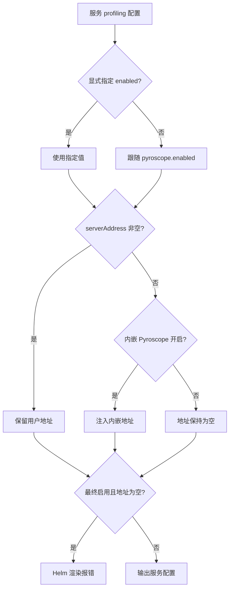

# Helm Chart 自监控指南

本文说明节点管理自身的指标、日志、链路追踪和 Profiling 可选套件。以下片段合入已完成业务配置的环境 values，不是独立的节点管理安装文件。首次部署见 [安装指南](INSTALL.md)，其他配置见 [配置参考](CONFIGURATION.md)，文档入口见 [Chart README](README.md)。

配置和示例以同一版本 Chart 为准；可选参数示例见 [values-example.yaml](values-example.yaml)。Grafana 的外部访问入口见 [Ingress 访问配置](CONFIGURATION.md#ingress-访问配置)。

> **使用范围与维护说明**：Grafana、Tempo、Alloy、Loki、Prometheus、Pyroscope、OpenTelemetry Collector（`opentelemetry-collector`，对应 `opentelemetryGateway` 配置）等自监控组件均为开源组件，仅作为用户自行管理的可选开发套件，不属于节点管理的标准能力，默认部署不提供这些组件（启用开关均为 `false`），用户应结合自身环境评估后决定是否启用。
>
> 该套件仅用于节点管理自身的指标、日志和链路追踪观测，可供未部署蓝鲸监控的环境按需使用。

自监控组件默认关闭，按需启用。Grafana 只负责展示，需要同时启用至少一个内嵌数据源：`tempo.enabled=true`、`prometheus.enabled=true`、`loki.enabled=true` 或 `pyroscope.enabled=true`。采集服务 trace 时，推荐启用 `opentelemetryGateway.enabled=true` 作为统一 OTLP Gateway，再由 Gateway 转发到 Tempo。

| 参数                         | 类型   | 默认值 | 描述                                                                   |
| ---------------------------- | ------ | ------ | ---------------------------------------------------------------------- |
| tempo.enabled                | bool   | false  | 启用内嵌 Tempo，用于存储和查询链路追踪数据                             |
| pyroscope.enabled            | bool   | false  | 启用内嵌 Pyroscope，未显式配置 profiling.enabled 的服务自动开始采集    |
| opentelemetryGateway.enabled | bool   | false  | 启用 OpenTelemetry Collector Gateway，作为服务 trace 的推荐入口        |
| prometheus.enabled           | bool   | false  | 启用内嵌 Prometheus，用于采集 bk-nodemgr 服务指标                      |
| loki.enabled                 | bool   | false  | 启用内嵌 Loki，用于存储并查询 Alloy 采集的 Kubernetes Pod 日志         |
| alloy.enabled                | bool   | false  | 启用内嵌 Alloy，以 DaemonSet 采集 Kubernetes Pod 日志并写入内嵌 Loki   |
| grafana.enabled              | bool   | false  | 启用内嵌 Grafana，用于查看 Tempo、Prometheus、Loki 和 Pyroscope 数据源 |
| grafana.rootURL              | string | 空     | Grafana 访问地址，启用 Grafana 时必填，需包含结尾 `/`                  |
| grafana.adminUser            | string | admin  | Grafana 管理员用户名                                                   |

## 组件与采集链路

完整自监控推荐启用示例：

```yaml
tempo:
  enabled: true
pyroscope:
  enabled: true
opentelemetryGateway:
  enabled: true
prometheus:
  enabled: true
loki:
  enabled: true
  singleBinary:
    persistence:
      enabled: true
      storageClass: ""
      size: 8Gi
alloy:
  enabled: true
grafana:
  enabled: true
  rootURL: https://nodemgr.example.com/grafana/
```

启用后，四类信号按以下链路进入 Grafana：

| 信号     | 采集入口                         | 存储/查询后端 | Grafana datasource uid  |
| -------- | -------------------------------- | ------------- | ----------------------- |
| Metrics  | 服务 `info-http` 端口 `/metrics` | Prometheus    | `bk-nodemgr-prometheus` |
| Traces   | OpenTelemetry Gateway OTLP       | Tempo         | `bk-nodemgr-tempo`      |
| Logs     | Alloy DaemonSet 采集 Pod 日志    | Loki          | `bk-nodemgr-loki`       |
| Profiles | 服务 profiling SDK 直接上报      | Pyroscope     | `bk-nodemgr-pyroscope`  |

## Profiling

Profiling 最小启用示例：

```yaml
pyroscope:
  enabled: true
grafana:
  enabled: true
  rootURL: https://nodemgr.example.com/grafana/
```

`application.config.profiling`、`backend.config.profiling`、`file.config.profiling` 分别控制服务采集。启用状态和上报地址独立解析，用户显式配置优先：

| 配置                                      | 解析规则                                         |
| ----------------------------------------- | ------------------------------------------------ |
| `enabled` 显式为 `true` 或 `false`        | 严格使用指定值                                   |
| 未指定 `enabled`                          | 跟随 `pyroscope.enabled`；仅填写地址不会启用采集 |
| `serverAddress` 非空                      | 保留用户地址                                     |
| `serverAddress` 为空且内嵌 Pyroscope 开启 | 注入内嵌 Service 的 HTTP 地址                    |
| 最终启用但没有可用地址                    | Helm 渲染报错                                    |



例如，`backend.config.profiling.enabled: false` 可在开启内嵌 Pyroscope 时关闭 backend 采集。连接外部 Pyroscope 且内嵌组件关闭时，必须同时配置 `enabled: true` 和 `serverAddress: https://profiles.example.com`。`applicationName`、`basicAuthUser`、`basicAuthPassword`、`tenantID`、`headers`、`tags` 和 `profileTypes` 按原有服务配置传递；`profileTypes` 留空使用 CPU 和内存采集默认值。

Profiles 通过现有 SDK 直接上报，不经过 OpenTelemetry Gateway 或日志 Alloy。Grafana 的内嵌 Pyroscope 数据源始终查询内嵌后端；给服务填写外部地址不会改写该数据源。服务最终 profiling 配置变化会触发 Pod 更新；修改内嵌数据源地址或端口后，按现有方式重启 Grafana 以加载 provisioning 配置。

内嵌 Pyroscope 默认以单副本运行，使用 filesystem 存储；默认未启用持久化，Pod 替换后数据丢失。需要保留数据时，参考 `values-example.yaml` 设置 `pyroscope.pyroscope.persistence`。本地存储配置不适用于跨 Pod 扩容。

## Trace 与指标

Trace 和指标最小启用示例：

```yaml
tempo:
  enabled: true
opentelemetryGateway:
  enabled: true
prometheus:
  enabled: true
grafana:
  enabled: true
  rootURL: https://nodemgr.example.com/grafana/
```

## 日志与存储

日志采集最小启用示例：

```yaml
loki:
  enabled: true
  singleBinary:
    persistence:
      enabled: true
      storageClass: ""
      size: 8Gi
alloy:
  enabled: true
grafana:
  enabled: true
  rootURL: https://nodemgr.example.com/grafana/
```

> 注: `tempo.enabled=true` 的默认 local 存储仅适合开发或验证环境；生产环境建议参考 `values-example.yaml` 配置对象存储。`loki.enabled=true` 默认使用 single-binary filesystem 存储，`loki.singleBinary.persistence.enabled=false` 仅适合开发或验证环境；生产环境建议参考 `values-example.yaml` 开启 PVC。`grafana.rootURL` 需要和实际 Ingress、网关或端口转发访问路径保持一致。

> 注: `alloy.enabled=true` 依赖 `loki.enabled=true`。Alloy 以 DaemonSet 在每个节点运行，默认只发现 Helm release 所在 namespace 的 Pod，并只采集容器名匹配 `bk-nodemgr-(application|backend|file)` 的日志；Helmfile 部署会显式指定三个业务 namespace。由于按容器名筛选，同 namespace 中同名的非节点管理容器也可能被采集。启用前请确认日志隐私、存储容量和节点资源开销符合预期。

## Grafana 访问

启用 Grafana 后，登录用户默认为 `admin`。管理员密码由 Grafana Chart 在 Secret 中生成并在升级时复用。若 ReleaseName 为 `bk-nodemgr`，默认 Secret 名称为 `bk-nodemgr-grafana`，可通过以下命令获取：

```shell
$ kubectl get secret -n <namespace> bk-nodemgr-grafana -o jsonpath='{.data.admin-password}' | base64 -d; echo
```

如果使用了其它 ReleaseName，请将 Secret 名称中的 `bk-nodemgr` 替换为实际 ReleaseName，例如 `<release-name>-grafana`。如果配置了 `grafana.fullnameOverride` 或 `grafana.nameOverride`，请以实际生成的 Secret 名称为准。

## Trace 上报配置与外部后端

自监控开启后，`application.config.tracing`、`backend.config.tracing`、`file.config.tracing` 控制三个服务的 trace exporter。推荐路径是服务先发往内嵌 OpenTelemetry Collector Gateway，再由 Gateway 转发到 Tempo。若 `opentelemetryGateway.enabled=true` 且对应服务未显式配置 `otlpEndpoint`，Chart 会自动将 trace 发往 Gateway；只有在未启用 Gateway、但启用了 `tempo.enabled=true` 时，才会回退为服务直连内嵌 Tempo。自动配置链路追踪上报时会写入 `exporterType: "otlp"`、`otlpProtocol: "grpc"`、`otlpInsecure: true`。

| 参数                                    | 类型   | 默认值 | 描述                                                               |
| --------------------------------------- | ------ | ------ | ------------------------------------------------------------------ |
| `<service>.config.tracing.exporterType` | string | stdout | trace exporter 类型；可设为 `otlp` 发往 OTLP backend               |
| `<service>.config.tracing.otlpEndpoint` | string | 空     | OTLP endpoint；为空时可根据已启用的内嵌自监控组件自动填充          |
| `<service>.config.tracing.otlpProtocol` | string | grpc   | OTLP 协议；合法值为 `grpc` 或 `http`，非法非空值会导致服务启动失败 |
| `<service>.config.tracing.otlpInsecure` | bool   | false  | 是否关闭 OTLP TLS 校验；自动配置上报至内嵌自监控组件时为 `true`    |
| `<service>.config.tracing.otlpHeaders`  | object | {}     | 发送 OTLP 请求时附加的 HTTP/gRPC metadata，例如鉴权 header         |

`<service>` 可替换为 `application`、`backend` 或 `file`。`otlpProtocol` 配置错误时，服务启动校验会返回 `otlp protocol is invalid`。启用自监控时，优先由 Chart 自动配置服务 trace 上报至 Gateway；需要转发到外部 OTLP HTTP backend 时，应配置 `opentelemetryGateway.alternateConfig`，由 Gateway 负责外发。`alternateConfig` 会完整替换 Collector 配置，因此需要同时声明 receiver、processor、exporter 和 pipeline。

通过 Gateway 转发到外部 OTLP HTTP backend 示例：

```yaml
opentelemetryGateway:
  enabled: true
  alternateConfig:
    receivers:
      otlp:
        protocols:
          grpc:
            endpoint: 0.0.0.0:4317
          http:
            endpoint: 0.0.0.0:4318
    processors:
      memory_limiter:
        limit_mib: 512
        spike_limit_mib: 128
        check_interval: 5s
      batch: {}
    exporters:
      otlphttp/external:
        endpoint: https://otel-collector.example.com:4318
        headers:
          Authorization: Bearer <token>
    extensions:
      health_check:
        endpoint: 0.0.0.0:13133
    service:
      extensions:
        - health_check
      pipelines:
        traces:
          receivers:
            - otlp
          processors:
            - memory_limiter
            - batch
          exporters:
            - otlphttp/external
```

仅在不启用 Gateway、且确实需要服务直连外部 OTLP backend 时，才直接配置 `<service>.config.tracing.otlpEndpoint` 和 `otlpProtocol`。服务进程的 OTLP HTTP endpoint 使用 `host:port`，trace 默认路径为 `/v1/traces`。
