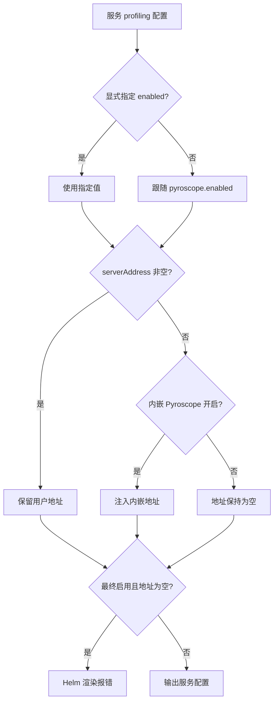

# BlueKing Node Manager Helm Chart

本 Chart 用于在 Kubernetes 中部署节点管理的 Application、Backend、File 服务，可按需部署内置 MongoDB、Redis、Etcd 和自监控组件。本文面向使用原生 Helm 的部署运维人员。

升级已有部署前，请先阅读 [Helm Chart 升级指南](UPGRADE.md)，按目标 Chart 版本检查需要人工迁移的 values 和部署行为变化。

**默认 values 不是可直接使用的环境配置**：其中包含示例地址、空凭证和示例密码。安装前必须完成下方配置清单；`values-example.yaml` 仅提供可选自监控和 Ingress 配置，不是完整安装配置。

- [部署前准备](#部署前准备)
- [准备环境配置](#准备环境配置)
- [安装 Chart](#安装-chart)
- [初始化与安装后验证](#初始化与安装后验证)
- [升级与回滚](#升级与回滚)
- [卸载与数据保留](#卸载与数据保留)
- [配置参考](#配置参考)

本文参数以同一 Chart 包内的 `values.yaml` 和依赖 Chart 为准。下方在线专题链接指向源码 `master`；使用已发布版本时，请在 GitHub 切换到目标版本对应的 tag 后阅读，避免将新配置套用到旧版本。Chart 版本、`appVersion` 与实际镜像版本需分别核对，`image.tag` 和各模块 `image.tag` 可以覆盖镜像版本。

## 部署前准备

### Kubernetes 与 Helm

- 使用 Helm 3，并确认当前 context、namespace 和部署权限。部署账户需要创建工作负载、Service、ConfigMap、Secret、PVC 及已启用组件所需的其他资源。
- 目标集群必须支持所启用模板和依赖 Chart 的 API。标准 Application Ingress 使用 `networking.k8s.io/v1`；BCS Ingress 需要预先安装对应的 Network Extension CRD 和控制器。不能将本 Chart 视为适用于所有 Kubernetes 1.12+ 集群。
- 启用自监控、KMS 或其他可选组件前，检查其依赖 Chart 的 Kubernetes 要求和 CRD 前提。先做本地渲染，再在目标环境验证 API 与控制器支持情况。
- 确保所有节点能够拉取主服务和依赖镜像；离线或私有仓库环境需准备镜像和同 namespace 的拉取凭证。

### 平台、网络与存储

| 项目          | 部署前需要确认                                                                                                                                                                                                                                                                                                                                                               |
| ------------- | ---------------------------------------------------------------------------------------------------------------------------------------------------------------------------------------------------------------------------------------------------------------------------------------------------------------------------------------------------------------------------- |
| BlueKing 平台 | 已有可用的 APIGateway、登录、CMDB、GSE、用户管理及 BKRepo；按所选 IAM 模式准备权限中心和回调地址。Chart 不负责安装这些平台服务                                                                                                                                                                                                                                               |
| 第三方权限    | 为实际 appCode 申请 [第三方 APIGateway 资源权限](https://github.com/TencentBlueKing/bk-nodemgr/blob/master/docs/operation/installation/thirdparty_apigateway_permission.md)，并准备 [BKRepo 资源与凭证](https://github.com/TencentBlueKing/bk-nodemgr/blob/master/docs/operation/installation/thirdparty_bkrepo_resource.md)；同步节点管理自己的网关不等于获得第三方调用权限 |
| 数据库        | 使用内置依赖或明确提供外部连接配置；MongoDB 必须为副本集。版本要求见 [安装部署](https://github.com/TencentBlueKing/bk-nodemgr/blob/master/docs/operation/installation.md)                                                                                                                                                                                                    |
| 网络          | Application/Backend/File 能访问数据库和平台依赖；APIGateway 能访问 Backend basic 服务，目标节点能访问 Backend callback 和 File download 服务，GSE 能访问 Backend proxy 服务。仅配置 Web Ingress 不足以建立这些通道                                                                                                                                                           |
| 宿主机网络    | Backend 和 File 默认 `hostNetwork: true`，需允许宿主机网络并规划监听端口、调度和副本，避免同节点端口冲突。修改为 Pod 网络前需重新确认节点及 GSE 的访问路由和通告地址                                                                                                                                                                                                         |
| 本地文件      | File 将 `file.config.mountHostDir`（默认 `/data/bk-nodemgr-file-mount/`）作为 hostPath 挂载到工作目录；确认目录权限、容量、备份及调度策略。该目录不是跨节点共享存储，Pod 换节点后不会自动迁移原目录数据                                                                                                                                                                      |
| 持久化        | 内置 MongoDB 默认申请 PVC；Redis 等依赖以子 Chart 实际渲染结果为准，不能仅凭顶层 `redis.persistence` 判断。为所有已启用的 PVC 准备 StorageClass 或 PV，并检查容量、回收策略与备份方案                                                                                                                                                                                        |

端口以 `<service>.config.*Server.port` 为准。Backend 默认 basic/callback/proxy 为 `28102/28103/28104`，File 默认 download 为 `28203`；管理端口不应作为公共入口开放。详细服务配置见 [安装部署](https://github.com/TencentBlueKing/bk-nodemgr/blob/master/docs/operation/installation.md)。

## 准备环境配置

将环境差异保存为 `values-env.yaml`，不要直接修改发行包内的默认 values。以下字段使用 **Chart 原生路径**；Helmfile 环境中的 `global.appSecret`、`global.serviceJwt` 等不会自动映射到这些路径。

### 必须确认的配置

| 配置位置                                                                                                                                                        | 何时需要及如何填写                                                                                                                                                                                          |
| --------------------------------------------------------------------------------------------------------------------------------------------------------------- | ----------------------------------------------------------------------------------------------------------------------------------------------------------------------------------------------------------- |
| `application.config.tenantMode`、`backend.config.tenantMode`、`file.config.tenantMode`                                                                          | 三个服务保持一致，合法值为 `single` 或 `multiple`；按目标平台的租户模式选择                                                                                                                                 |
| `application.config.backend`                                                                                                                                    | 节点管理网关的完整阶段 URL，以及具备调用权限的 `appCode`、`appSecret`、调用用户或 token                                                                                                                     |
| `backend.config.cmdb`、`backend.config.gse`、`backend.config.userManager`、`file.config.gse`                                                                    | 各平台网关的实际 `endpoints`、应用凭证和所选 `authMode` 所需认证信息；GSE 插件能力还需确认两处 `pluginSlotID/pluginSlotToken`                                                                               |
| `application.config.userManager`                                                                                                                                | 用户管理网关地址、应用凭证与调用身份；多租户用户解析依赖该配置                                                                                                                                              |
| `application.config.bkSaaS.bkLogin`、`application.config.front`                                                                                                 | 登录 API 的 `endpoints`、应用凭证、浏览器可访问的 `loginURL`、匹配平台的 `authType` 及页面使用的 BlueKing URL                                                                                               |
| `application.config.access.virtualUser`、`backend.config.access.virtualUser`                                                                                    | 如覆盖默认虚拟用户，填写环境中实际可用的用户；未指定时单租户默认 `admin`，多租户默认 `bk_admin`                                                                                                             |
| `file.config.repo`                                                                                                                                              | BKRepo 直连 `endpoint/projectID/repoName/accessKey/secretKey`，不是 APIGateway 地址。多租户模式仍填写原始 `projectID`，请求时会转换为 `system.<projectID>`                                                  |
| `backend.config.basicServer.jwtServerConfig.publicKeyPem`                                                                                                       | Backend 校验 APIGateway JWT 的 PEM 公钥，由网关平台提供，不是服务间共享密钥                                                                                                                                 |
| `*.config.adminServer.jwtServerConfig.symmetricKey`、`application.config.file.jwtClientConfig.symmetricKey`、`backend.config.file.jwtClientConfig.symmetricKey` | 配置服务间 JWT，并配置 `file.config.basicServer.jwtServerConfig.symmetricKey`；下方片段采用同一份环境专用密钥，File 客户端密钥必须与 File basic 服务端匹配                                                  |
| `backend.config.encryptKey`                                                                                                                                     | 安装前替换示例加密密钥，并安全保存；不要在已有数据的环境中随意轮换密钥或加密套件                                                                                                                            |
| `backend.config.iamV3`、`backend.config.iamV4`、`application.config.iamV3`                                                                                      | 明确选择运行时权限方案，Backend 的 V3/V4 不能同时启用；两者都关闭会跳过 Backend 授权，不应以关闭鉴权作为部署排障手段。网关地址、应用凭证、system ID 与回调地址需匹配已注册模型                              |
| `backend.config.system`、`backend.config.gseDeployConfs`                                                                                                        | 确认 GSE 环境标识、版本类型、节点操作系统及安装路径；列表覆盖时必须保留所需的完整操作系统配置                                                                                                               |
| `backend.config.networkUnit.defaultDirectUnit`                                                                                                                  | 新环境按 [默认直连网络单元配置](https://github.com/TencentBlueKing/bk-nodemgr/blob/master/docs/operation/installation/default_direct_unit.md) 准备真实 GSE 通道；默认关闭，不能仅开启开关而保留空 endpoints |
| `etcd/redis/mongodb` 或 `externalEtcd/externalRedis/externalMongodb`                                                                                            | 确定依赖部署模式、认证、TLS、存储与备份；替换所有示例密码。切换外置依赖时须关闭对应内置组件，参数见下方公共组件配置                                                                                         |

本地 values 可能包含凭证，应限制文件访问权限，避免提交到仓库或粘贴完整渲染结果。普通模式的部分凭证会进入 ConfigMap 和 Helm release 记录，应同时限制 namespace 与 release 数据的读取权限。需要 KMS 时见下方 [KMS 凭证集成](#kms-凭证集成)，不要混用两种模式的凭证来源。

### 原生 Helm values 片段

以下片段展示单租户模式、服务间 JWT 和 BKRepo 的配置位置，**不是完整安装文件**。所有 `<...>` 必须替换，并按上表补齐平台 endpoints、应用凭证、登录、IAM、数据库密码及访问入口；多租户环境需同时调整三个 `tenantMode`。

```yaml
application:
  config:
    tenantMode: single
    adminServer:
      jwtServerConfig:
        symmetricKey: "<SERVICE_JWT_KEY>"
    file:
      jwtClientConfig:
        symmetricKey: "<SERVICE_JWT_KEY>"
backend:
  config:
    tenantMode: single
    encryptKey: "<ENV_ENCRYPT_KEY>"
    basicServer:
      jwtServerConfig:
        publicKeyPem: |
          <APIGATEWAY_PUBLIC_KEY_PEM>
    adminServer:
      jwtServerConfig:
        symmetricKey: "<SERVICE_JWT_KEY>"
    file:
      jwtClientConfig:
        symmetricKey: "<SERVICE_JWT_KEY>"
file:
  config:
    tenantMode: single
    adminServer:
      jwtServerConfig:
        symmetricKey: "<SERVICE_JWT_KEY>"
    basicServer:
      jwtServerConfig:
        cryptoType: symmetric
        symmetricKey: "<SERVICE_JWT_KEY>"
    repo:
      endpoint: "https://<BKREPO_HOST>"
      projectID: "<BKREPO_PROJECT>"
      repoName: "<BKREPO_REPOSITORY>"
      accessKey: "<BKREPO_ACCESS_KEY>"
      secretKey: "<BKREPO_SECRET_KEY>"
```

多份 `-f` 文件按从左到右覆盖，同名字段以后面的文件为准；map 递归合并，列表整体替换。例如覆盖 `apigwSync.extraEnvVars`、`apigwSync.config.stages` 或 `backend.config.gseDeployConfs` 时，需写出该列表所需的完整内容，不能只添加单个条目。可选配置的更多示例见同包 `values-example.yaml`，选取需要的片段合入环境文件，不要直接将整份示例用于生产。

## 安装 Chart

以下命令以 release 和 namespace 均为 `bk-nodemgr` 为例。替换仓库地址和目标 Chart 版本；release 名称应包含 `bk-nodemgr`，如更改名称，后续检查命令也需同步调整。

```shell
helm repo add bk <HELM_REPO_URL>
helm repo update bk
helm show chart bk/bk-nodemgr --version <CHART_VERSION>
helm show values bk/bk-nodemgr --version <CHART_VERSION> > values-default.yaml
```

结合目标版本的默认值完成 `values-env.yaml` 后，先在本地检查。在保存该环境文件的目录执行以下命令，下载并解压对应 Chart；提前确认 `bk-nodemgr` 子目录不存在，避免覆盖已有文件：

```shell
helm pull bk/bk-nodemgr --version <CHART_VERSION> --untar
helm lint ./bk-nodemgr -f values-env.yaml
helm template bk-nodemgr ./bk-nodemgr --namespace bk-nodemgr -f values-env.yaml > rendered.yaml
```

`rendered.yaml` 可能包含凭证和私钥，需按敏感文件保存并在检查后清理。本地 lint/template 只检查 Chart 和模板输出，不会执行初始化 Job，也不证明平台权限、镜像、存储或网络可用。

确认目标 context、配置和 Hook 副作用后安装：

```shell
helm install bk-nodemgr bk/bk-nodemgr \
  --version <CHART_VERSION> \
  --namespace bk-nodemgr --create-namespace \
  -f values-env.yaml --wait --timeout 15m
```

根据镜像拉取、数据库启动和初始化包大小调整超时。`--wait` 等待资源就绪，启用的 Hook Job 还需执行成功；安装命令返回成功不代表业务验收完成。失败时先保留错误和相关日志，再按下一节排查，不要通过反复升级或关闭鉴权盲目重试。

## 初始化与安装后验证

### 初始化和同步 Job

这些操作会写入外部平台或制品数据，安装前必须确认目标环境和执行权限。未启用的操作需由平台管理员或已有流程完成，不能因为开关关闭就省略业务前提。

| 操作                     | 实际启用条件                                       | 执行时机与准备事项                                                                                                                                                                                                                                                              |
| ------------------------ | -------------------------------------------------- | ------------------------------------------------------------------------------------------------------------------------------------------------------------------------------------------------------------------------------------------------------------------------------- |
| 包初始化                 | `file.enabled=true` 且 `initPackages.enabled=true` | 默认仅 `post-install`；`initPackages.installOnly=false` 时也在 `post-upgrade` 执行。准备调用用户、File JWT 和镜像内包；证书包需要完整 GSE 证书材料，详见 [初始化包导入](https://github.com/TencentBlueKing/bk-nodemgr/blob/master/docs/operation/installation/init_packages.md) |
| 节点管理 APIGateway 同步 | `apigwSync.enabled=true`                           | `post-install,post-upgrade`；配置 `extraEnvVars` 中的网关、应用凭证和地址模板，以及 `config.stages` 的阶段和 Backend 地址；按 [网关同步权限](https://github.com/TencentBlueKing/bk-nodemgr/blob/master/docs/operation/installation/apigw_sync_permission.md) 准备权限           |
| IAM V3 模型同步          | `backend.config.iamV3.enable=true`                 | `post-install,post-upgrade`；配置 Backend IAM 连接与 `iamV3.system/provider`。当前 Job 不由顶层 `iamV3.enabled` 控制，不能靠该字段阻止同步                                                                                                                                      |
| IAM V4 模型同步          | `iamV4.enabled=true`                               | `post-install,post-upgrade`；凭证和网关取自 `backend.config.iamV4`，另配 `iamV4.system/provider`；与运行时 `backend.config.iamV4.enable` 独立，详见下方 IAM V4 模型同步                                                                                                         |

上述业务 Hook 成功后会按 `hook-succeeded` 删除，下次执行前也会删除旧同名 Hook。应保留安装输出及必要日志；**Job 不存在不代表未执行，Job 成功也不代表包或权限已满足业务要求**。包目录为空时初始化可能没有导入任何包，需继续检查包清单和默认版本。

APIGateway 的 `NO_PUB=true` 不是 dry-run，也不保证不发布：同步仍可能写入网关、阶段、资源和授权；`RELEASE_STAGES` 非空时仍会执行对应阶段的发布。开启前检查两个参数与同步目标；启用 MCP 同步时，按 [MCP 内置特性与完整覆写](#mcp-内置特性与完整覆写) 选择产品内置清单或各 stage 的显式定义，排查见 [APIGateway 同步 FAQ](https://github.com/TencentBlueKing/bk-nodemgr/blob/master/docs/faq/apigw-sync.md)。

### 检查资源与业务结果

```shell
helm status bk-nodemgr --namespace bk-nodemgr
kubectl get pods,deploy,statefulset,svc,pvc,jobs --namespace bk-nodemgr
kubectl get events --namespace bk-nodemgr --sort-by=.lastTimestamp
```

逐项确认：

- **资源启动**：已启用服务的 Deployment/StatefulSet 就绪，Pod 无异常重启，PVC 已绑定。若 initContainer 卡住，检查其数据库地址、认证和网络；不要只看主容器日志。
- **失败定位**：对异常 Pod 执行 `kubectl describe pod <POD_NAME> -n bk-nodemgr`，再用 `kubectl logs <POD_NAME> -c <CONTAINER_NAME> -n bk-nodemgr` 查看对应主容器或 initContainer；重启过的容器可增加 `--previous`。不要外传未脱敏日志。
- **同步结果**：检查已启用 Hook 的结果及失败日志；确认网关阶段、路由后端和授权、IAM 模型与回调实际可用。Hook 可能已清理，也需检查外部平台结果。
- **入口与登录**：配置 Application Ingress 或已有访问入口，确认 DNS/TLS、登录跳转、租户及用户身份正确，页面能够加载业务数据。Application Service 为 NodePort，按环境限制其访问范围，不要暴露 admin 端口。
- **安装能力**：确认所需证书包、工具包和 Agent/插件包已导入并设置正确的默认版本，网络区域/网络单元具有实际 GSE 通道；在授权的测试主机上验证一次安装及状态回传。

Ingress 默认关闭；配置方式见下方 Ingress 访问配置。仅用于本机检查 Application 连通性时，也可在确认 Service 名称后转发其 `basic-http` 端口：

```shell
kubectl port-forward --namespace bk-nodemgr svc/bk-nodemgr-application 8080:basic-http
```

转发后访问 `http://127.0.0.1:8080`；登录回跳仍受平台域名、Cookie 和回调配置约束，端口转发不替代正式访问入口。设置过 `fullnameOverride/nameOverride` 时以实际 Service 名称为准。

## 配置参考

下列为关键配置，不是全量字段清单；完整参数及依赖组件配置以同包 `values.yaml` 和 `charts/*/values.yaml` 为准。

### 全局公共配置

**Chart全局配置**

| 参数             | 类型   | 默认值                     | 描述         |
| ---------------- | ------ | -------------------------- | ------------ |
| image.registry   | string | hub.bktencent.com          | 镜像源地址   |
| image.repository | string | blueking/bk-nodemgr-server | 服务镜像     |
| image.tag        | string | Chart对应的既定版本号      | 服务镜像标签 |
| image.pullPolicy | string | IfNotPresent               | 镜像拉取策略 |

### 用户 Wiki 指引链接

`backend.config.wiki` 配置 backend 用户可见任务日志中的产品 Wiki 链接，默认为 `github` 模式：

```yaml
backend:
  config:
    wiki:
      mode: github
      github:
        repositoryURL: https://github.com/TencentBlueKing/bk-nodemgr
```

`github` 模式的仓库地址不包含 tag 或文档目录；backend 根据自身版本解析结果构建发布 tag，文档位于该 tag 的 `support-files/wiki/zh/` 和 `support-files/wiki/en/` 下，中文、英文任务提示分别链接到对应语言的文档。构建标记不作为 tag 的一部分；`debug` 等无法解析为发布版本的构建回退到 `master`，此时文档可能与运行版本不同。旧配置未指定 `wiki` 时使用上述默认值。阅读该模式的指引需要用户能够访问 GitHub。

无法访问 GitHub 的环境可切换为 `application` 模式，使用 application 服务随产品提供的文档，无需访问外网：

```yaml
backend:
  config:
    wiki:
      mode: application
      application:
        prefixURL: https://nodemgr.example.com/wiki/
application:
  config:
    wiki:
      enabled: true
```

application 的 Wiki 默认关闭，需设置 `application.config.wiki.enabled: true` 才会注册 `/wiki/` 路由；设为 `false` 后不提供文档访问。该开关不改变 backend 的链接模式，关闭前需确认 backend 不再生成指向该入口的链接。

`application.prefixURL` 必须配置为用户可访问的绝对文档 URL 前缀，而不是集群内服务地址；默认空值仅适用于 `github` 模式。请确保用户访问入口将 `/wiki/` 路径转发至 application 服务，并将前缀设置为对应的外部地址。

backend 在该前缀后拼接 `zh/` 或 `en/` 及相对文件路径。例如，中文 SSH 排障指引为 `https://nodemgr.example.com/wiki/zh/troubleshooting/unix-ssh-connection-failed.md`。application 返回原始 Markdown，不提供 HTML 渲染；文档可免登录访问，请勿在产品 Wiki 中放置敏感信息。

### IAM V3 模型同步

启用 `backend.config.iamV3.enable` 后，安装和升级会自动执行 IAM V3 模型同步 Job。`iamV3.option.allowActionReplace` 默认为 `false`；设为 `true` 时，Job 向 `do_migrate.py` 传入 `--allow-action-replace`，允许清理策略、删除旧 Action 并按目标资源绑定重建。此开关作用于本次全目录同步中所有发生资源绑定变化的 `upsert_action`，不只限于 `package_history_view`。

```yaml
iamV3:
  option:
    allowActionReplace: true
```

启用前需确认目标系统、租户及全部绑定变更。**策略删除不可逆，已有授权不会自动迁移**；同步后需重新配置并验证受影响的权限。完成改绑后将此开关恢复为 `false`，后续同步对相同绑定只执行普通更新。关闭开关或回退 Chart 无法恢复已删除的策略。

Helmfile 部署时，将上述片段合并到对应 environment 的 `overrides/backend.yaml`。服务运行时 IAM 配置保持不变。使用的 server 镜像需包含支持 `--allow-action-replace` 的迁移脚本；IAM 版本要求、异步删除及失败恢复边界见 [IAM V3 迁移工具](https://github.com/TencentBlueKing/bk-nodemgr/blob/master/support-files/bkiamv3/README.md#显式替换-action-资源绑定)。

### MCP 内置特性与完整覆写

在已有网关凭证、地址和 `config.stages` 配置上合并以下片段，可同步并启用产品内置的 MCP，无需复制资源清单：

```yaml
apigwSync:
  enabled: true
  mcp:
    enabled: true
```

`apigwSync.mcp.enabled` 默认关闭；开启时优先于 `extraEnvVars` 中的 `ENABLE_SYNC_MCP_SERVERS`，自动启用 MCP 同步。它不自动发布网关资源：`config.spec_version` 必须为 `2`，对应 stage 需已发布包含 MCP 所引用资源的版本。内置清单由同步镜像中的产品定义提供；开启特性时将其 `status` 设为 `1`，其他字段沿用产品定义，不额外更改公开性、OAuth 或调用权限。当前内置拓扑查询 MCP 使用 `OpenTopo_*` 资源、`Official` 分类，保持非公开、关闭 public client OAuth，允许 personal client token。

各 stage 的配置优先级如下，不按 MCP 名称或字段合并：

| `config.stages[].mcp_servers` | 行为                                                                     |
| ----------------------------- | ------------------------------------------------------------------------ |
| 未设置                        | 新开关开启时使用产品内置清单；关闭时不注入                               |
| 显式非空列表                  | 完整使用该列表，包括资源、状态、公开性及 OAuth 配置，不追加内置 MCP      |
| 显式 `[]`                     | 不注入内置定义，跳过该 stage 的 MCP 同步；不会删除或停用网关中已有的 MCP |

关闭新开关后，仍可通过原 `ENABLE_SYNC_MCP_SERVERS=true` 同步显式提供的完整定义。同步镜像在运行时读取部署配置和内置清单，生成只包含非空 MCP 定义的 `/data/mcp-definition.yaml`；新开关关闭且缺少定义，或显式提供空列表的 stage 不参与 MCP 同步。需要停用已有 MCP 时，应显式提供完整定义并设置 `status: 0`，不能用空列表代替。

产品内置 MCP 只维护在仓库 `apigw/mcp_servers.yaml` 的 `mcp_servers` 列表中，不包含 stage 或后端配置。新增或调整 MCP 后，正常构建并升级 apigw-sync 镜像即可，无需修改 Helm 模板或复制清单到 values。镜像中的 `/data/mcp_servers.yaml` 不受部署 ConfigMap 覆盖；所有未显式覆写的 stage 共用该清单。

直接运行同步镜像的脚本时，设置 `ENABLE_SYNC_MCP_SERVERS=true` 开启同步，另设 `ENABLE_BUILTIN_MCP_SERVERS=true` 使用内置清单；与 Chart 使用相同的装配和覆写规则。`mcp_servers.yaml` 不是可直接传给网关同步命令的完整 definition，应使用脚本生成的 `/data/mcp-definition.yaml`。

**升级注意：** 默认 `stages` 不再携带 MCP 清单。此前仅设置 `ENABLE_SYNC_MCP_SERVERS=true`、依赖 Chart 默认清单的部署，应迁移为 `apigwSync.mcp.enabled=true`；新开关会启用内置 MCP。若需保持停用状态或其他自定义策略，请在对应 stage 显式保留完整定义。已有显式 MCP 定义保持原样，不会被新开关改写。Chart 与同步镜像需配套升级，旧镜像不支持专用 MCP 同步文件。

### IAM V4 模型同步

`iamV4.option.allowActionReplace` 默认为 `false`。设为 `true` 后，同步 Job 在 Action 资源绑定冲突时自动复用 `replace_action`，以 `cascade: ["role"]` 清理角色中的旧 Action 成员，再删除重建 Action，后续角色同步恢复模板中声明的成员。自定义角色中未在模板声明的成员不会自动恢复；不级联清理 RBAC/ABAC 授权。日志输出旧/新绑定及替换风险；IAM 拒绝删除时立即停止，不自动扩大级联范围或回滚。已有授权不会自动迁移，启用前需确认目标租户和受影响权限。此行为需要使用包含角色级联清理逻辑的工具镜像。

```yaml
iamV4:
  enabled: true
  option:
    allowActionReplace: true
```

运行时 `backend.config.iamV4.enable` 与本节 Job 开关独立；注册的 `iamV4.system.id` 应与运行时 `backend.config.iamV4.systemID` 一致，`provider.host/path` 必须形成 IAM 实际可访问的回调 URL。详细说明见 [IAM V4 迁移工具](https://github.com/TencentBlueKing/bk-nodemgr/blob/master/support-files/bkiamv4/README.md)。

### KMS 凭证集成

`kms.enabled` 默认 `false`。启用后通过 External Secrets Operator（ESO）从 KMS/Vault 拉取全局与已启用模块的凭证，服务启动时读取并解密 envelope，覆盖对应凭证字段；Chart 不安装 ESO 或 KMS 服务。

启用前需完成：

- 在集群安装支持目标 Chart 所用资源版本的 ESO 控制器与 CRD，并确认其能够访问 KMS。
- 配置真实 `kms.server`、`kms.tls` 和 `kms.modules.{global,application,backend,file}` 的 `path/role/credential`；这些值来自目标环境的 KMS 凭证注册结果，不应直接沿用示例。
- 为目标 namespace 的 ServiceAccount 完成 KMS Kubernetes auth 授权。默认 `serviceAccount.create=false` 且名称为空时使用 `default`，需按实际账户绑定 role。
- 准备 TLS/mTLS 所引用的 Secret，确认 ExternalSecret 已同步、目标 Secret 已生成后再检查服务启动。ESO 刷新 Secret 不等于服务已重新加载凭证，轮换时还需确认相应服务的加载方式。

普通 values 中的空凭证不能代替 KMS 侧的注册、授权和同步；排障时只查看状态与必要的脱敏信息，不输出 Secret 或完整 envelope。

### 公共组件配置

`etcd.enabled`、`redis.enabled`、`mongodb.enabled` 默认均为 `true`。使用外部服务时，将对应开关设为 `false` 并填写相应 `external*`；只设置外置地址而不关闭内置组件，不会切换连接。内置依赖的高可用、认证和持久化由各子 Chart 配置，需结合实际渲染结果检查。

外置 Redis 片段（合入完整 `values-env.yaml`）：

```yaml
redis:
  enabled: false
externalRedis:
  type: standalone
  addrs:
    - "redis.example.com:6379"
  password: "<REDIS_PASSWORD>"
  db: 0
```

不使用 `externalRedis.host/port/username` 配置连接，当前模板读取的是 `addrs`。

**外置Etcd配置**

| 参数                   | 类型   | 默认值               | 描述                                                      |
| ---------------------- | ------ | -------------------- | --------------------------------------------------------- |
| externalEtcd.endpoints | list   | `["127.0.0.1:2379"]` | 外置 Etcd endpoint 列表，使用外置服务时必须替换为实际地址 |
| externalEtcd.username  | string | 空                   | 外置etcd服务username                                      |
| externalEtcd.password  | string | 空                   | 外置etcd服务password                                      |
| externalEtcd.tls.ca    | string | 空                   | 外置etcd服务的客户端证书CA内容(base64编码)                |
| externalEtcd.tls.cert  | string | 空                   | 外置etcd服务的客户端证书Cert内容(base64编码)              |
| externalEtcd.tls.key   | string | 空                   | 外置etcd服务的客户端证书Key内容(base64编码)               |

**外置Redis配置**

| 参数                     | 类型   | 默认值     | 描述                                                                                       |
| ------------------------ | ------ | ---------- | ------------------------------------------------------------------------------------------ |
| externalRedis.type       | string | standalone | 外置 Redis 类型：`standalone`、`cluster` 或 `sentinel`                                     |
| externalRedis.addrs      | list   | []         | `host:port` 列表；standalone 填单个服务地址，cluster 填节点地址，sentinel 填 Sentinel 地址 |
| externalRedis.password   | string | 空         | 外置 Redis 服务密码                                                                        |
| externalRedis.db         | int    | 0          | standalone/sentinel 数据库编号，cluster 模式忽略                                           |
| externalRedis.masterName | string | 空         | sentinel 模式的 master 名称                                                                |
| externalRedis.tls.ca     | string | 空         | 外置redis服务的客户端证书CA内容(base64编码)                                                |
| externalRedis.tls.cert   | string | 空         | 外置redis服务的客户端证书Cert内容(base64编码)                                              |
| externalRedis.tls.key    | string | 空         | 外置redis服务的客户端证书Key内容(base64编码)                                               |

**外置MongoDB配置**

| 参数                           | 类型   | 默认值          | 描述                                                              |
| ------------------------------ | ------ | --------------- | ----------------------------------------------------------------- |
| externalMongodb.replicaSetName | string | rs0             | 外置mongodb服务replica set名称                                    |
| externalMongodb.hosts          | array  | `[""]`          | 外置 MongoDB 地址列表；mongodb.enabled=false 时必须替换为实际地址 |
| externalMongodb.username       | string | nodemgr         | 外置mongodb服务用户名                                             |
| externalMongodb.password       | string | defaultpassword | 外置mongodb服务密码                                               |
| externalMongodb.database       | string | nodemgr         | 外置mongodb服务DB名称                                             |
| externalMongodb.authSource     | string | admin           | 外置mongodb服务认证数据库                                         |
| externalMongodb.authMechanism  | string | SCRAM-SHA-256   | 外置mongodb服务认证机制                                           |
| externalMongodb.tls.ca         | string | 空              | 外置mongodb服务的客户端证书CA内容(base64编码)                     |
| externalMongodb.tls.cert       | string | 空              | 外置mongodb服务的客户端证书Cert内容(base64编码)                   |
| externalMongodb.tls.key        | string | 空              | 外置mongodb服务的客户端证书Key内容(base64编码)                    |

### 自监控配置

> **使用范围与维护说明**：Grafana、Tempo、Alloy、Loki、Prometheus、Pyroscope、OpenTelemetry Collector（`opentelemetry-collector`，对应 `opentelemetryGateway` 配置）等自监控组件均为开源组件，仅作为用户自行管理的可选开发套件，不属于节点管理的标准能力，默认部署不提供这些组件（启用开关均为 `false`），用户应结合自身环境评估后决定是否启用。
>
> 该套件仅用于节点管理自身的指标、日志和链路追踪观测，可供未部署蓝鲸监控的环境按需使用。

自监控组件默认关闭，按需启用。Grafana 只负责展示，需要同时启用至少一个内嵌数据源：`tempo.enabled=true`、`prometheus.enabled=true`、`loki.enabled=true` 或 `pyroscope.enabled=true`。采集服务 trace 时，推荐启用 `opentelemetryGateway.enabled=true` 作为统一 OTLP Gateway，再由 Gateway 转发到 Tempo。

| 参数                         | 类型   | 默认值 | 描述                                                                   |
| ---------------------------- | ------ | ------ | ---------------------------------------------------------------------- |
| tempo.enabled                | bool   | false  | 启用内嵌 Tempo，用于存储和查询链路追踪数据                             |
| pyroscope.enabled            | bool   | false  | 启用内嵌 Pyroscope，未显式配置 profiling.enabled 的服务自动开始采集    |
| opentelemetryGateway.enabled | bool   | false  | 启用 OpenTelemetry Collector Gateway，作为服务 trace 的推荐入口        |
| prometheus.enabled           | bool   | false  | 启用内嵌 Prometheus，用于采集 bk-nodemgr 服务指标                      |
| loki.enabled                 | bool   | false  | 启用内嵌 Loki，用于存储并查询 Alloy 采集的 Kubernetes Pod 日志         |
| alloy.enabled                | bool   | false  | 启用内嵌 Alloy，以 DaemonSet 采集 Kubernetes Pod 日志并写入内嵌 Loki   |
| grafana.enabled              | bool   | false  | 启用内嵌 Grafana，用于查看 Tempo、Prometheus、Loki 和 Pyroscope 数据源 |
| grafana.rootURL              | string | 空     | Grafana 访问地址，启用 Grafana 时必填，需包含结尾 `/`                  |
| grafana.adminUser            | string | admin  | Grafana 管理员用户名                                                   |

完整自监控推荐启用示例：

```yaml
tempo:
  enabled: true
pyroscope:
  enabled: true
opentelemetryGateway:
  enabled: true
prometheus:
  enabled: true
loki:
  enabled: true
  singleBinary:
    persistence:
      enabled: true
      storageClass: ""
      size: 8Gi
alloy:
  enabled: true
grafana:
  enabled: true
  rootURL: https://nodemgr.example.com/grafana/
```

启用后，四类信号按以下链路进入 Grafana：

| 信号     | 采集入口                         | 存储/查询后端 | Grafana datasource uid  |
| -------- | -------------------------------- | ------------- | ----------------------- |
| Metrics  | 服务 `info-http` 端口 `/metrics` | Prometheus    | `bk-nodemgr-prometheus` |
| Traces   | OpenTelemetry Gateway OTLP       | Tempo         | `bk-nodemgr-tempo`      |
| Logs     | Alloy DaemonSet 采集 Pod 日志    | Loki          | `bk-nodemgr-loki`       |
| Profiles | 服务 profiling SDK 直接上报      | Pyroscope     | `bk-nodemgr-pyroscope`  |

Profiling 最小启用示例：

```yaml
pyroscope:
  enabled: true
grafana:
  enabled: true
  rootURL: https://nodemgr.example.com/grafana/
```

`application.config.profiling`、`backend.config.profiling`、`file.config.profiling` 分别控制服务采集。启用状态和上报地址独立解析，用户显式配置优先：

| 配置                                      | 解析规则                                         |
| ----------------------------------------- | ------------------------------------------------ |
| `enabled` 显式为 `true` 或 `false`        | 严格使用指定值                                   |
| 未指定 `enabled`                          | 跟随 `pyroscope.enabled`；仅填写地址不会启用采集 |
| `serverAddress` 非空                      | 保留用户地址                                     |
| `serverAddress` 为空且内嵌 Pyroscope 开启 | 注入内嵌 Service 的 HTTP 地址                    |
| 最终启用但没有可用地址                    | Helm 渲染报错                                    |



例如，`backend.config.profiling.enabled: false` 可在开启内嵌 Pyroscope 时关闭 backend 采集。连接外部 Pyroscope 且内嵌组件关闭时，必须同时配置 `enabled: true` 和 `serverAddress: https://profiles.example.com`。`applicationName`、`basicAuthUser`、`basicAuthPassword`、`tenantID`、`headers`、`tags` 和 `profileTypes` 按原有服务配置传递；`profileTypes` 留空使用 CPU 和内存采集默认值。

Profiles 通过现有 SDK 直接上报，不经过 OpenTelemetry Gateway 或日志 Alloy。Grafana 的内嵌 Pyroscope 数据源始终查询内嵌后端；给服务填写外部地址不会改写该数据源。服务最终 profiling 配置变化会触发 Pod 更新；修改内嵌数据源地址或端口后，按现有方式重启 Grafana 以加载 provisioning 配置。

内嵌 Pyroscope 默认以单副本运行，使用 filesystem 存储；默认未启用持久化，Pod 替换后数据丢失。需要保留数据时，参考 `values-example.yaml` 设置 `pyroscope.pyroscope.persistence`。本地存储配置不适用于跨 Pod 扩容。

Trace 和指标最小启用示例：

```yaml
tempo:
  enabled: true
opentelemetryGateway:
  enabled: true
prometheus:
  enabled: true
grafana:
  enabled: true
  rootURL: https://nodemgr.example.com/grafana/
```

日志采集最小启用示例：

```yaml
loki:
  enabled: true
  singleBinary:
    persistence:
      enabled: true
      storageClass: ""
      size: 8Gi
alloy:
  enabled: true
grafana:
  enabled: true
  rootURL: https://nodemgr.example.com/grafana/
```

> 注: `tempo.enabled=true` 的默认 local 存储仅适合开发或验证环境；生产环境建议参考 `values-example.yaml` 配置对象存储。`loki.enabled=true` 默认使用 single-binary filesystem 存储，`loki.singleBinary.persistence.enabled=false` 仅适合开发或验证环境；生产环境建议参考 `values-example.yaml` 开启 PVC。`grafana.rootURL` 需要和实际 Ingress、网关或端口转发访问路径保持一致。

> 注: `alloy.enabled=true` 依赖 `loki.enabled=true`。Alloy 以 DaemonSet 在每个节点运行，默认只发现 Helm release 所在 namespace 的 Pod，并只采集容器名匹配 `bk-nodemgr-(application|backend|file)` 的日志；Helmfile 部署会显式指定三个业务 namespace。由于按容器名筛选，同 namespace 中同名的非节点管理容器也可能被采集。启用前请确认日志隐私、存储容量和节点资源开销符合预期。

启用 Grafana 后，登录用户默认为 `admin`。管理员密码由 Grafana Chart 在 Secret 中生成并在升级时复用。若 ReleaseName 为 `bk-nodemgr`，默认 Secret 名称为 `bk-nodemgr-grafana`，可通过以下命令获取：

```shell
$ kubectl get secret -n <namespace> bk-nodemgr-grafana -o jsonpath='{.data.admin-password}' | base64 -d; echo
```

如果使用了其它 ReleaseName，请将 Secret 名称中的 `bk-nodemgr` 替换为实际 ReleaseName，例如 `<release-name>-grafana`。如果配置了 `grafana.fullnameOverride` 或 `grafana.nameOverride`，请以实际生成的 Secret 名称为准。

自监控开启后，`application.config.tracing`、`backend.config.tracing`、`file.config.tracing` 控制三个服务的 trace exporter。推荐路径是服务先发往内嵌 OpenTelemetry Collector Gateway，再由 Gateway 转发到 Tempo。若 `opentelemetryGateway.enabled=true` 且对应服务未显式配置 `otlpEndpoint`，Chart 会自动将 trace 发往 Gateway；只有在未启用 Gateway、但启用了 `tempo.enabled=true` 时，才会回退为服务直连内嵌 Tempo。自动配置链路追踪上报时会写入 `exporterType: "otlp"`、`otlpProtocol: "grpc"`、`otlpInsecure: true`。

| 参数                                    | 类型   | 默认值 | 描述                                                               |
| --------------------------------------- | ------ | ------ | ------------------------------------------------------------------ |
| `<service>.config.tracing.exporterType` | string | stdout | trace exporter 类型；可设为 `otlp` 发往 OTLP backend               |
| `<service>.config.tracing.otlpEndpoint` | string | 空     | OTLP endpoint；为空时可根据已启用的内嵌自监控组件自动填充          |
| `<service>.config.tracing.otlpProtocol` | string | grpc   | OTLP 协议；合法值为 `grpc` 或 `http`，非法非空值会导致服务启动失败 |
| `<service>.config.tracing.otlpInsecure` | bool   | false  | 是否关闭 OTLP TLS 校验；自动配置上报至内嵌自监控组件时为 `true`    |
| `<service>.config.tracing.otlpHeaders`  | object | {}     | 发送 OTLP 请求时附加的 HTTP/gRPC metadata，例如鉴权 header         |

`<service>` 可替换为 `application`、`backend` 或 `file`。`otlpProtocol` 配置错误时，服务启动校验会返回 `otlp protocol is invalid`。启用自监控时，优先由 Chart 自动配置服务 trace 上报至 Gateway；需要转发到外部 OTLP HTTP backend 时，应配置 `opentelemetryGateway.alternateConfig`，由 Gateway 负责外发。`alternateConfig` 会完整替换 Collector 配置，因此需要同时声明 receiver、processor、exporter 和 pipeline。

通过 Gateway 转发到外部 OTLP HTTP backend 示例：

```yaml
opentelemetryGateway:
  enabled: true
  alternateConfig:
    receivers:
      otlp:
        protocols:
          grpc:
            endpoint: 0.0.0.0:4317
          http:
            endpoint: 0.0.0.0:4318
    processors:
      memory_limiter:
        limit_mib: 512
        spike_limit_mib: 128
        check_interval: 5s
      batch: {}
    exporters:
      otlphttp/external:
        endpoint: https://otel-collector.example.com:4318
        headers:
          Authorization: Bearer <token>
    extensions:
      health_check:
        endpoint: 0.0.0.0:13133
    service:
      extensions:
        - health_check
      pipelines:
        traces:
          receivers:
            - otlp
          processors:
            - memory_limiter
            - batch
          exporters:
            - otlphttp/external
```

仅在不启用 Gateway、且确实需要服务直连外部 OTLP backend 时，才直接配置 `<service>.config.tracing.otlpEndpoint` 和 `otlpProtocol`。服务进程的 OTLP HTTP endpoint 使用 `host:port`，trace 默认路径为 `/v1/traces`。

### Application 登录接口

`application.config.bkSaaS.bkLogin.useLegacyAPI` 默认为 `false`。保持默认值且 `authType=bk_token` 时，所有租户模式均使用 `/open/bk-tokens/userinfo/`，需要配置可访问该接口的 `endpoints` 和网关应用凭证 `appCode`、`appSecret`，以及所选 `authMode` 所需的认证参数。`loginURL` 仍用于浏览器登录跳转，不能代替 API 网关地址。

`useLegacyAPI: true` 仅支持 `application.config.tenantMode=single`，不支持多租户。`authType=bk_ticket` 的接口与认证行为不变。旧版单租户环境的影响范围、迁移示例和验证要求见 [v3.0.1-alpha.114 升级说明](UPGRADE.md#v301-alpha114)。

### 用户标识兼容与平台升级

`backend.config.userManager.useLegacyUsername` 和 `application.config.userManager.useLegacyUsername` 均默认为 `false`，必须在两个服务中同步配置。该开关仅控制是否沿用 `bk_username = login_name` 的旧用户标识规则，与 `tenantMode` 独立；`tenantMode` 仍负责租户模式，不用于判断用户标识体系。

以下 7.2/7.3 指**蓝鲸平台大版本**，不是节点管理版本：

| 蓝鲸平台 | 租户模式             | 两个服务的 `userManager.useLegacyUsername` | 用户标识处理                                                       |
| -------- | -------------------- | ------------------------------------------ | ------------------------------------------------------------------ |
| 7.2      | 非多租户（`single`） | `true`                                     | 沿用 `bk_username = login_name`，不调用 lookup                     |
| 7.3      | `single`             | `false`                                    | 按当前租户通过用户管理 lookup 将 `login_name` 映射为 `bk_username` |
| 7.3      | `multiple`           | `false`                                    | 按当前租户通过用户管理 lookup 将 `login_name` 映射为 `bk_username` |

仍运行蓝鲸 7.2 平台时，即使升级节点管理，也必须保留两个服务的 `useLegacyUsername: true`：

```yaml
backend:
  config:
    userManager:
      useLegacyUsername: true
application:
  config:
    userManager:
      useLegacyUsername: true
```

蓝鲸平台从 7.2 升级到 7.3 时，必须同步将两个服务切换为 `false`，并为节点管理应用开通用户管理 `/open/tenant/virtual-users/-/lookup/` 的调用权限，确保 `userManager.endpoints`、应用凭证及请求租户标识与目标环境一致。7.3 关闭多租户后的 `single` 模式不等同于 7.2 旧版，仍需 lookup。lookup 请求失败、无权限或未找到用户时会返回错误，**不会回退为 `bk_username = login_name`**；应修复权限、租户或用户数据，而不是通过开启兼容开关绕过。

使用 Helmfile 时，在 environment 的 `backend.config.userManager` 和 `application.config.userManager` 中同步设置该字段；Docker Compose 在两个服务的配置模板中提供固定默认值 `false`，部署到蓝鲸 7.2 前须同步改为 `true`。本开关不替代 `application.config.bkSaaS.bkLogin.useLegacyAPI`，登录接口的兼容配置仍按上一节选择。

### Ingress 访问配置

Ingress 默认关闭。按访问对象区分为三类：`application.ingress` 用于节点管理 Web/API 服务入口，`backend.ingress` 用于 backend TCP 服务入口，`grafana.ingress` 用于自监控 Grafana 入口。

**Application Ingress**

`application.ingress` 支持两种模式：`className` 为空时使用 BCS Network Extension Ingress；`className` 非空时使用标准 Kubernetes Ingress。

| 参数                                | 类型   | 默认值              | 描述                                            |
| ----------------------------------- | ------ | ------------------- | ----------------------------------------------- |
| application.ingress.enabled         | bool   | false               | 是否创建 application Ingress                    |
| application.ingress.lbid            | string | 空                  | BCS Network Extension 负载均衡实例 ID           |
| application.ingress.lbPolicy        | string | WRR                 | BCS 负载均衡策略，可选 `WRR`、`LEAST_CONN`      |
| application.ingress.isDirectConnect | bool   | true                | BCS Network Extension 是否使用直连模式          |
| application.ingress.certID          | string | 空                  | BCS HTTPS 证书 ID，配置后使用 HTTPS 监听        |
| application.ingress.domain          | string | nodemgr.example.com | 访问域名                                        |
| application.ingress.path            | string | /                   | 访问路径                                        |
| application.ingress.className       | string | 空                  | 标准 Kubernetes IngressClass 名称，例如 `nginx` |
| application.ingress.tlsSecretName   | string | 空                  | 标准 Kubernetes Ingress TLS Secret 名称         |

标准 Kubernetes Ingress 示例：

```yaml
application:
  ingress:
    enabled: true
    className: nginx
    domain: nodemgr.example.com
    path: /
    tlsSecretName: nodemgr-tls
```

BCS Network Extension Ingress 示例：

```yaml
application:
  ingress:
    enabled: true
    lbid: <bcs-lb-id>
    lbPolicy: WRR
    isDirectConnect: true
    certID: <bcs-cert-id>
    domain: nodemgr.example.com
    path: /
```

**Backend Ingress**

`backend.ingress` 创建的是 BCS Network Extension TCP Ingress，会暴露 `backend.config.basicServer.port` 和 `backend.config.proxyServer.port`。

| 参数                            | 类型   | 默认值 | 描述                                       |
| ------------------------------- | ------ | ------ | ------------------------------------------ |
| backend.ingress.enabled         | bool   | false  | 是否创建 backend TCP Ingress               |
| backend.ingress.lbid            | string | 空     | BCS Network Extension 负载均衡实例 ID      |
| backend.ingress.lbPolicy        | string | WRR    | BCS 负载均衡策略，可选 `WRR`、`LEAST_CONN` |
| backend.ingress.isDirectConnect | bool   | true   | 是否使用直连模式                           |

```yaml
backend:
  ingress:
    enabled: true
    lbid: <bcs-lb-id>
    lbPolicy: WRR
    isDirectConnect: true
```

**Grafana Ingress**

`grafana.enabled=true` 只会创建 Grafana 服务，默认不会创建外部访问入口。需要通过 Ingress 访问 Grafana 时，请同时启用 `grafana.ingress.enabled=true`，并确保 `grafana.rootURL` 与 Ingress 的域名和路径一致。

| 参数                             | 类型   | 默认值              | 描述                            |
| -------------------------------- | ------ | ------------------- | ------------------------------- |
| grafana.ingress.enabled          | bool   | false               | 是否创建 Grafana Ingress        |
| grafana.ingress.ingressClassName | string | 空                  | IngressClass 名称，例如 `nginx` |
| grafana.ingress.hosts            | list   | chart-example.local | Grafana 访问域名                |
| grafana.ingress.path             | string | /                   | Grafana 访问路径                |
| grafana.ingress.pathType         | string | Prefix              | Ingress 路径匹配类型            |
| grafana.ingress.tls              | list   | []                  | HTTPS 证书配置                  |

```yaml
grafana:
  enabled: true
  rootURL: https://nodemgr.example.com/grafana/
  ingress:
    enabled: true
    ingressClassName: nginx
    hosts:
      - nodemgr.example.com
    path: /grafana
    pathType: Prefix
    tls:
      - secretName: nodemgr-grafana-tls
        hosts:
          - nodemgr.example.com
```

> 注: 使用子路径访问 Grafana 时，`grafana.rootURL` 必须包含相同子路径并以 `/` 结尾，例如 `https://nodemgr.example.com/grafana/`。如果只使用根路径访问，可将 `grafana.ingress.path` 设置为 `/`，并将 `grafana.rootURL` 设置为对应域名根路径。

## 升级与回滚

先按 [升级指南](UPGRADE.md) 完成版本迁移、环境覆盖核对、资源检查及备份，再升级已有的 `bk-nodemgr` release：

```shell
helm history bk-nodemgr --namespace bk-nodemgr
helm upgrade bk-nodemgr bk/bk-nodemgr \
  --version <TARGET_CHART_VERSION> \
  --namespace bk-nodemgr --reset-values \
  -f values-env.yaml --wait --timeout 15m
```

请替换 namespace、目标 Chart 版本及环境文件路径；使用其他 release 名称时也需相应替换。`values-env.yaml` 必须包含当前环境的全部必要覆盖，遗漏的配置不会从旧 release 自动恢复。升级后的验证和回滚边界见 [检查最终资源与外部副作用](UPGRADE.md#检查最终资源与外部副作用)。

升级会再次执行已启用的 APIGateway/IAM 同步 Job；`initPackages.installOnly=false` 时还会重新导入并设置包默认版本。执行前确认这些副作用符合预期，升级后重复“初始化与安装后验证”的检查。不要通过 `--no-hooks` 跳过业务所需同步来掩盖失败。

需要回滚时，先确认旧版本能够读取当前数据、密钥及外部平台配置，再选择历史 revision：

```shell
helm rollback bk-nodemgr <REVISION> --namespace bk-nodemgr --wait --timeout 15m
```

**Helm rollback 不是数据恢复**：不会撤销 MongoDB/BKRepo 的数据变化、包默认版本、网关或 IAM 已完成的变更，也不会恢复宿主机目录。即使使用自动回滚选项，也需单独处置外部副作用；不满足数据兼容条件时按相应版本的恢复方案操作。

## 卸载与数据保留

确认数据备份、业务停用范围和保留策略后卸载：

```shell
helm uninstall bk-nodemgr --namespace bk-nodemgr
```

该命令删除 Helm 管理的 release 资源，不代表删除全部业务数据或完成外部平台注销：

- StatefulSet 创建的 PVC、标记保留的资源或 Hook 资源可能继续存在，按实际资源和删除策略检查；手工删除 PVC/PV 前确认回收策略，避免永久丢失数据。
- File 的 hostPath 目录不随 release 删除；需要人工按备份与清理策略处理，不能仅因 Pod 已删除就清理目录。
- 外置数据库、BKRepo 制品、APIGateway 配置和 IAM 模型/授权不会自动撤销；需由对应平台管理员确认清理范围。
- 不要将删除 namespace 作为通用清理步骤，其中可能还有其他 release、共享 Secret 或数据资源。
