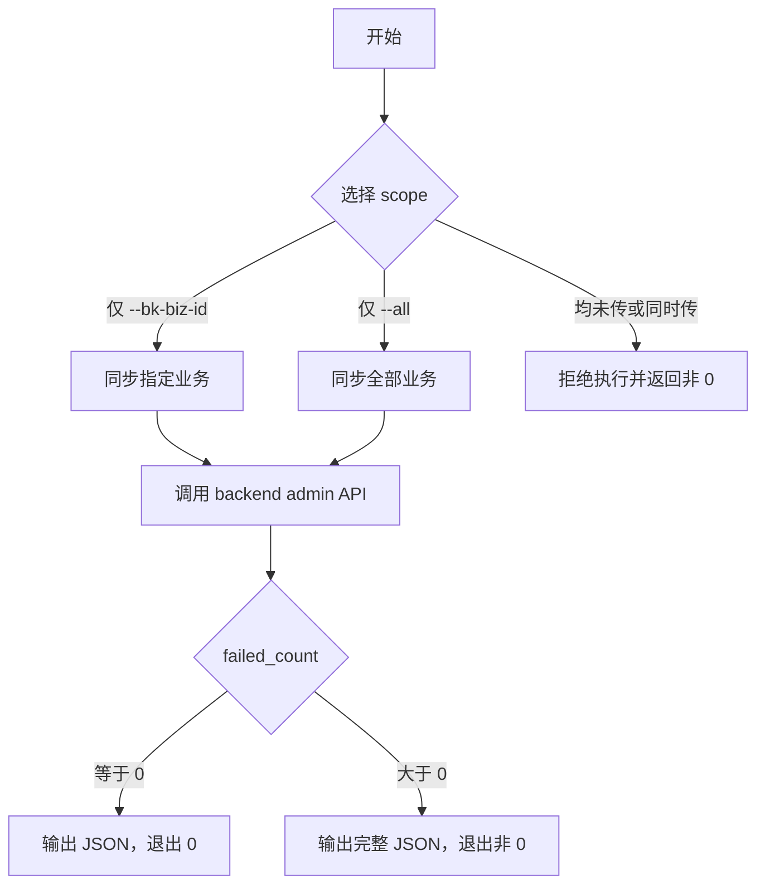

# Ops Scripts

`script_tools/ops` 提供本地日志检索、配置发现和命令包装等运维快速入口。涉及鉴权、请求签名和接口调用时，由项目内置 CLI 或对应工具完成。

## 按 Trace ID 查本地日志

```bash
/bk-nodemgr/script/ops/trace.sh 878b57b35a5334997e67e1ec5e99de44
```

只接受一个 32 位小写十六进制 Trace ID，精确匹配 `trace-id(<traceid>)`，输出 `文件名:行号:日志原文`。
自动检索当前容器 `/bk-nodemgr/log` 目录下的普通文件（含当前及轮转日志），跳过符号链接以避免重复扫描。
不依赖 exporter，不跨 Pod 查询；只能找到已落盘且带该 Trace ID 的日志。

退出码：`0` 找到匹配，`1` 未找到匹配，`2` 参数、目录或文件读取错误。读取错误时可能已输出部分匹配，请以退出码为准。

## 同步未分配 Network Unit 的 Agent

```bash
./sync_unassigned_network_unit.sh (--bk-biz-id 2,3 | --all)
```

该脚本调用：

```text
sync_unassigned_network_unit.sh -> bk-nodemgr-adminclient -> backend admin API
```

目标接口：`POST /admin/node/agent/sync_unassigned_network_unit`。

### Scope 规则

必须显式选择一个 scope：

| 参数              | 语义             |
| ----------------- | ---------------- |
| `--bk-biz-id 2,3` | 只同步指定业务   |
| `--all`           | 显式同步全部业务 |

规则：

1. 未传 `--bk-biz-id` 且未传 `--all`：拒绝执行。
2. 同时传 `--bk-biz-id` 和 `--all`：拒绝执行。
3. `--all` 会触发全业务扫描，只在确认需要全量修复时使用。



### Quick Start

指定业务：

```bash
cd /bk-nodemgr/script/ops
./sync_unassigned_network_unit.sh --bk-biz-id 2,3
```

全业务：

```bash
cd /bk-nodemgr/script/ops
./sync_unassigned_network_unit.sh --all
```

指定配置文件和认证用户：

```bash
./sync_unassigned_network_unit.sh \
  -c /bk-nodemgr/etc/backend_conf.yaml \
  --login-name admin \
  --bk-biz-id 2
```

### 配置发现

未传 `-c/--config` 时，脚本只按以下顺序检查 backend 配置，避免误用其他服务的 `adminServer`：

1. `${CONF_DIR:-/bk-nodemgr/etc}/backend_conf.yaml`
2. `${CONF_DIR:-/bk-nodemgr/etc}/bk-nodemgr-backend.yml`

两个文件都不存在时拒绝执行。可通过 `CONF_DIR` 覆盖配置目录：

```bash
CONF_DIR=/data/bk-nodemgr/etc ./sync_unassigned_network_unit.sh --bk-biz-id 2
```

如果 `bk-nodemgr-adminclient` 不在默认路径 `/bk-nodemgr/bin/bk-nodemgr-adminclient` 或 `PATH` 中，可以指定：

```bash
ADMINCLIENT_BIN=/path/to/bk-nodemgr-adminclient ./sync_unassigned_network_unit.sh --bk-biz-id 2
```

### 输出与退出码

成功调用后，stdout 输出接口返回 JSON：

```json
{
  "success_count": 10,
  "failed_count": 0,
  "failed_reasons": []
}
```

退出码规则：

| 场景                                                                            | 退出码                  |
| ------------------------------------------------------------------------------- | ----------------------- |
| 参数错误、配置错误、找不到 `bk-nodemgr-adminclient`、传入不支持的 `--tenant-id` | 非 0                    |
| HTTP 调用失败或 backend admin API 返回错误                                      | 非 0                    |
| API 成功且 `failed_count == 0`                                                  | 0                       |
| API 成功但 `failed_count > 0`                                                   | 非 0，并仍输出完整 JSON |

`failed_count > 0` 表示部分 Host 未能完成同步，原因见 `failed_reasons`。
